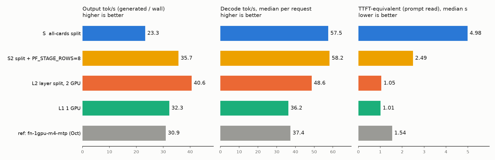

# Running the all-cards split engine on 2x GeForce 16 GB (host-memory expert cache)

This branch (`split-geforce-16gb`, based on `v0.2.10` / `ffa80d7`) carries two small, opt-in patches that let the
all-cards split engine start and answer on two 16 GB GeForce cards, where the routed experts do **not** fit in VRAM.
With none of the new environment variables set, behaviour is exactly as upstream. The license (MIT) and the original
authors' credits are unchanged.

Tested once, on one machine, with one model (see "Numbers"). Treat this as a field report, not a supported configuration.

## What changed

1. **`strata_control/split_engine.py`: environment switches for the launcher rule (default unchanged).**
   - `STRATA_SPLIT_SKIP_VRAM_CHECK=1`: `decide()` no longer refuses when the experts do not fit in the cards' memory;
     it records "experts larger than the cards' memory (host-memory expert cache)" as untested instead
     (still needs `STRATA_SPLIT_ALLOW_UNTESTED=1` as before).
   - `STRATA_SPLIT_FNX_ARENA` and `STRATA_SPLIT_FNX_EXPERT_RAM_GIB`: replace the values `split_config()` forces
     (`FNX_ARENA=0`, `FNX_EXPERT_RAM_GIB=off`), so the engine's existing host-RAM expert cache and arena can be used.
2. **`src/split/src/model.cpp`: `FNX_POOL_MIN_RESIDENT=N` (default 0 = upstream).** `choose_residency()` never takes a
   size pool below N resident experts.

## Why it was needed

- **Launcher rule.** The engine already supports keeping a pinned host copy of the experts and filling VRAM slots from
  it (`choose_residency()`, the "VRAM short" loop), but the launcher refuses to start when the experts do not fit in
  VRAM, and forces the arena and the expert-RAM cache off.
- **Pool floor.** IQ3_S mixes quantization types per layer, so the experts fall into 7 size pools. The expert cache needs
  `2*MAXT*TOPK` (320) slots in *every* pool. `choose_residency()` moves the coldest-per-byte experts to host memory first,
  which empties the small pools first (here pool 3 = 3 layers, 1,536 experts), and `place_experts()` then throws:
  `expert cache: pool 3 has 235 slots, a window needs 320 (fewer experts in RAM)` for every `FNX_EXPERT_RAM_GIB` from 12
  up, while the default 3 GiB runs out of VRAM (`expert cache: slots: out of memory`). On larger cards the required
  `R` is small and this probably never shows. The floor keeps every pool above the slot count the cache needs. The
  "VRAM short" loop goes through the same function, so the floor applies there too.
- **mlock.** The engine pins about 80 GiB here (29.5 GB of embeddings plus the pinned expert copy). A stock Linux desktop
  has `ulimit -l` around 16 GiB, so the load stops with
  `fnx: mlock of per_layer_token_embd.weight (27465 MiB) failed: Cannot allocate memory; run with RLIMIT_MEMLOCK raised`.
  No code change is needed, but the limit has to be raised for the engine process (see below). Workstations with an
  unlimited memlock will not see this.

## Hardware and software used

- GIGABYTE X570 AORUS PRO WIFI, Ryzen 5 5600, 128 GB DDR4 (125 GiB seen by the OS)
- 2x GeForce RTX 4060 Ti 16 GB (sm_89), both CPU-attached PCIe Gen4 x8, no P2P
- NVMe on Gen3 x4
- Ubuntu 22.04.4, kernel 6.8, NVIDIA driver 615.71.09 (CUDA 13.4)
- CUDA toolkit from pip (CUDA 13.4, nvcc 13.4.92); cmake and ninja from a Python venv
- Model: Qwen3.8-Flash-Next GSQ-RCO IQ3_S (2 files, checksums verified), 46.8 GiB of routed experts, plus the MTP draft (Q2_0)

## Build

1. `git clone --branch split-geforce-16gb https://github.com/nabe2030/Strata.git`
2. Unpack the llama.cpp commit pinned in `setup.py` (3cf0325) and point `GG` at it.
3. Build the split engine for sm_89 with two cards:

   ```
   SRC=<Strata checkout> B=<build dir> CUDA=<cuda-root> GG=<llama.cpp> ARCH=89 CARDS=2 JOBS=8 \
     packaging/build_split_cuda.sh
   ```

   There were no sm_89-specific compile errors (warnings only), and the peer-function check at the end of the script passed.
4. Install the binary as `strata-split-2-sm89` and put `libcudart`, `libcublas` and `libcublasLt` (`.so.13`) next to it
   (the binary uses `RUNPATH $ORIGIN`).

## Run

Environment for the engine:

```
FNX_ARENA=1
FNX_EXPERT_RAM_GIB=20
FNX_POOL_MIN_RESIDENT=384      # 2*MAXT*TOPK = 320, plus a margin
FNX_PF_STAGE_ROWS=8            # optional, see "Results on the same box" (default 2048)
```

Engine arguments: `--spec 6 --lookup 15 --batch 1 --max-context 8192 --conversation-cache-mib 1024`

Raise the memlock limit for the engine process only, for example:

```
sudo prlimit --memlock=unlimited --pid <engine pid>
# or start the engine under:  sudo prlimit --memlock=unlimited -- <command>
```

Server: `serve/server.py --engine strata --config cfg.json`, where `cfg.json` sets `exe` to the engine binary and
`drafting` to `mtp`. Leave `split_fallback` out of the config on purpose, so a failed start is not hidden by a fallback.
Confirm that the split engine really runs from the engine log (`engine started: ...strata-split-2-sm89`, then the
`fnx:` lines).

If you start through the launcher instead, the matching switches are
`STRATA_SPLIT_SKIP_VRAM_CHECK=1 STRATA_SPLIT_ALLOW_UNTESTED=1` (and optionally `STRATA_SPLIT_FNX_ARENA`,
`STRATA_SPLIT_FNX_EXPERT_RAM_GIB`). **The launcher path (`strata launch`) was not run in this test**; the server was
given the run configuration directly.

## Numbers

Settings: `FNX_ARENA=1 FNX_EXPERT_RAM_GIB=20 FNX_POOL_MIN_RESIDENT=384`, `--spec 6 --lookup 15 --batch 1`, context 8192,
temperature 0, through `serve/server.py`.

| `FNX_EXPERT_RAM_GIB` | Experts in RAM at the end | Short-prompt decode (tok/s, 3 runs) | 3.5K-token prompt (tok/s) | VRAM free per card | Load |
|---|---|---|---|---|---|
| 16 | n/a | fails to start (`prefill: cudaMalloc ... out of memory`) | n/a | n/a | n/a |
| 20 | 17,502 of 24,576 | 51.0 / 59.6 / 53.4 | 769 | about 0.8 GiB | 99 s |
| 30 | 17,258 of 24,576 | 51.4 / 60.8 / 54.9 | 806 | about 0.55 GiB | 97 s |

- With R=20, 7,074 experts (29 %) stay in VRAM and 17,502 (71 %) are in host memory; 7,453 of those were moved by the
  "VRAM short" loop. About 15.2 GB of VRAM is used per card.
- MTP draft acceptance was about 45 to 55 % (K=6). One tool call through the OpenAI route worked.
- GPU temperature stayed below 60 C.
- R=20 and R=30 end almost at the same residency because the "VRAM short" loop decides the final count. R of 16 or less
  runs out of memory before that loop.

Caveats:

- **A large `rsync` was reading the same NVMe during these measurements**, so the numbers are indicative only.
- No comparison against the normal layer split on the same machine, no quality suite, no context beyond 8192,
  no `--batch` above 1, and a single model/quant were tried.
- `FNX_POOL_MIN_RESIDENT=384` is a value that worked here, not a tuned one.

## Results on the same box

Same machine as above, nothing else running (no `rsync`), 200 ShareGPT requests sent one at a time (`vllm bench serve`,
seed 0, concurrency 1, thinking off, server default sampling), context 8192, MTP drafter. The same 200 prompts were used
for every run (47,455 input tokens in total). Timings are recomputed from the engine's own per-request log lines, because
the client-side TTFT is not meaningful for this server. **One run per configuration**, so treat differences of a few
percent as noise.



| | S (this branch) | S2 (this branch + `FNX_PF_STAGE_ROWS=8`) | L2 (layer split, 2 cards) | L1 (1 card) |
|---|---|---|---|---|
| Generated tokens / wall time | 23.3 tok/s | 35.7 | **40.6** | 32.3 |
| Decode, median per request | 57.5 tok/s | **58.2** | 48.7 | 36.3 |
| Prompt read, median | 4.98 s | 2.49 | 1.05 | **1.01** |
| Prompt read, p99 | 11.9 s | 3.2 | 2.3 | **2.0** |
| Wall time for 200 requests | 1875 s | 1248 s | **1106 s** | 1374 s |
| Failed requests | 0 | 0 | 0 | 0 |

- **S / S2**: the split engine built from this branch (`strata-split-2-sm89`) with `FNX_ARENA=1 FNX_EXPERT_RAM_GIB=20
  FNX_POOL_MIN_RESIDENT=384`, `--spec 6 --lookup 15 --batch 1`. S2 only adds `FNX_PF_STAGE_ROWS=8`.
- **L2 / L1**: the stock release engine `strata` 0.1.56 (Linux, CUDA 13) from the v0.2.10 release, MTP drafter
  (`--spec 6`), the same GGUF, with `--layer-split auto` on two cards (L2) or on one card only (L1). `--lookup` does not
  exist in that engine, so it was not used there.
- Not shown in the table: the draft acceptance counts are not comparable between the two engines (different logging).

**Reading the numbers.** The split engine decodes fastest (S2 is 1.2x the layer split and 1.6x one card), but on short
prompts it loses on total throughput, because every prompt has to move the non-resident experts over PCIe. A prompt is
read in two passes (the first N-6 rows, then the last 6). Below `FNX_PF_STAGE_ROWS` (default 2048) a pass reads the
RAM-resident experts in place; above it they are staged with `cudaMemcpy`, about 1.6 s per pass here. With 71 % of the
experts in RAM the in-place path costs 2.4 s (41 rows) to 5.7 s (772 rows), and the 6-row tail pass costs 1.4 s when
staged but 0.3 s in place. `FNX_PF_STAGE_ROWS=8` uses the staged path for the head and the in-place path for the tail:

| Prompt read time | default (2048) | `FNX_PF_STAGE_ROWS=8` |
|---|---|---|
| about 50 tokens | 3.0 s | 2.0 s |
| about 200 tokens | 3.9 s | 2.1 s |
| about 780 tokens | 6.0 s | 2.4 s |
| about 3.4K tokens | about 4.4 s | 4.3 s |

`FNX_PF_STAGE_MIB=768` only helped long prompts (3.4K tokens: 4.3 to 3.7 s) and was not used. `FNX_PF_STAGE_ROWS=0`
(always stage) did not help short prompts. The default of 2048 seems to assume all experts are resident in VRAM; this
is discussed in the upstream issue.

**Agent workload (GembaBench).** The same box, both engines at `--max-context 262144` (one slot, MTP drafter, 4 GiB conversation cache), running the
[GembaBench](https://github.com/nabe2030/gembabench) agent benchmark (18 runs: six tasks, three runs each, driven by OpenCode through the OpenAI-compatible
server). The split engine is this branch with `FNX_ARENA=1 FNX_EXPERT_RAM_GIB=20 FNX_POOL_MIN_RESIDENT=384 FNX_PF_STAGE_ROWS=8`; the layer split is the stock 0.1.56 engine.

| | split engine | layer split (2 cards) |
|---|---|---|
| Wall time for all 18 runs | **5.7 h** | 7.3 h |
| Generation speed seen by the agent (median of 18 runs) | **43.6 tok/s** | 35.8 tok/s |
| Task scores | same as the layer split | same |

One run per configuration of each task set; one of the split-engine runs spent 33 minutes in a model-initiated `sleep`, which is included in the 5.7 h. Details and per-run data are in the benchmark repository.

Caveats: one machine, one model/quant, one run each; short ShareGPT prompts (about 240 tokens on average) with
about 220 generated tokens, concurrency 1 only. The comparison between engine versions also mixes the 0.1.56 release
build with a v0.2.10 source build of the split engine.

## Files

- `strata_control/split_engine.py`: patch 1 (launcher switches)
- `src/split/src/model.cpp`: patch 2 (pool floor)
- `docs/split-geforce-16gb-same-box.png`: chart for "Results on the same box"
